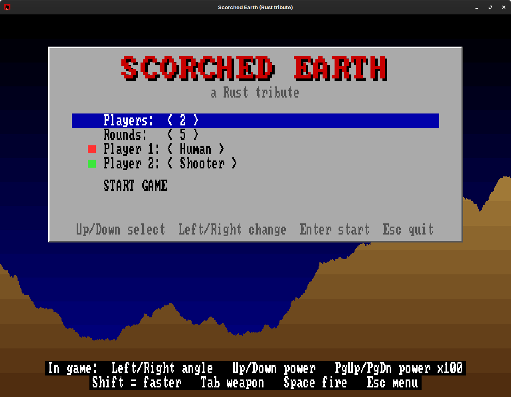

# Scorched Earth – Rust tribute

A 90s-style remake of the DOS classic: 640×480 software framebuffer, chunky
VGA-style gradients, DOS 8×16 font, scaled up with crisp nearest-neighbour pixels.
Built on [macroquad](https://macroquad.rs).

---



---


## Requirements (Linux / Manjaro)

1. **Rust toolchain** (cargo + rustc). Either:
   - `sudo pacman -S rustup && rustup default stable` (system package), or
   - the official installer, no sudo needed, installs into `~/.cargo`:
     `curl --proto '=https' --tlsv1.2 -sSf https://sh.rustup.rs | sh`
2. **System libraries** for the window/graphics/audio (already on a standard
   Manjaro desktop): `sudo pacman -S --needed base-devel libx11 libxi mesa alsa-lib`

If `cargo` is installed in `~/.cargo/bin` but your shell can't find it, add this
to `~/.zshrc`:

```sh
export PATH="$HOME/.cargo/bin:$PATH"
```

(The Makefile adds that path itself, so `make` works even without it.)

## Build & run

The first build downloads dependencies from crates.io and takes a minute; later
builds are quick.

| Command | What it does |
|---|---|
| `make run` | Build optimised and start the game (**use this to play**) |
| `make build` | Only build; the binary is `target/release/scorched` |
| `make dev` | Debug build + run (compiles faster, runs a bit slower) |
| `make check` | Type-check the code without building |
| `make fmt` | Format the code (needs `rustup component add rustfmt`) |
| `make clean` | Remove the `target/` build directory |
| `make help` | List the targets |

Without make, the same thing is `cargo run --release`.
Run regression tests with `cargo test`.

After `make build` you can start the game directly with `./target/release/scorched`,
or copy that single file anywhere; it has no other files to go with it.

The window opens at 1280×960 (the 640×480 game doubled) and can be resized;
the picture is scaled by whole numbers when it fits, keeping pixels sharp.

## How to play

In the main menu use Up/Down to select a button and Enter to choose it.
Left/Right changes counters; highlighted hotkeys advance values, and
Alt+hotkey moves backward. Left/right mouse clicks also advance/reverse values.
Esc or a click outside closes an option dialog. Greyed-out options are planned
features whose gameplay is not implemented yet.

Choose Players (2–10) and Rounds (1–1000, default 10), then Start (`S`).
In controller setup, choose Human, Moron, Shooter or Spoiler for each player
with Left/Right, Enter or mouse clicks. The number keys `1`–`9`/`0` select and
cycle a player's controller; Alt reverses the cycle. Choose Done or press `D`
to begin. Esc returns to the main menu.

Players take turns; the current tank has a blinking arrow over it.
The last tank standing wins the
round. Basic and Standard rank players by cash; Greedy ranks by cash plus
80% of the current value of held inventory. Both round-over and final screens
show the cash standings. The first
player each round is random; subsequent turns follow tank positions from left
to right, wrapping at the edge.

Starter ammunition is granted once per game. Unused stock carries between rounds;
other items are capped at 99, and Baby Missiles stay unlimited (displayed as 99).
The catalogue includes all original items, with nine weapons currently playable.
Opening purchases are available with positive Cash at Start. Between-round
shopping and accessories are planned for later batches.

## Settings

Settings load from `~/.config/scorched/settings.toml` (or the equivalent user
config directory on other platforms). Choose **Save Changes** (`C`) to keep
changes for the next launch. Unsaved changes last only for this session.
Missing files use defaults; invalid files show an error and use defaults.

To use a different file, run `./target/release/scorched myconfig.toml`, or
`cargo run --release -- myconfig.toml`. Save Changes writes to that file.
A partial TOML file can override only the options you need, for example:

```toml
players = 4
rounds = 20

[hardware]
firing_delay = 50
falling_delay = 10
```

Hardware **Firing Delay** (0–500, default 100) controls shot animation speed;
lower values are faster, and zero skips the wait. **Falling Delay** (0–1000,
default 10) sets milliseconds per falling-tank pixel; zero falls immediately.
The Physics menu (`Y`) also enables Air Viscosity, Gravity (0.05–10 in 0.05
steps), Suspend Dirt, Tanks Fall, and Borders Extend. In Landscape (`L`), Max.
Wind and Changing Wind are active. PgUp/PgDn changes counters by ten steps.
Remaining greyed-out options become active in later feature batches.

Gravity defaults to 0.2, giving acceleration 500; power is used directly as
launch speed, capped at 1000. Viscosity slows shots. Borders Extend allows shots
to leave the side edges and return with the wind. Suspend Dirt is the percentage
chance that floating soil stays suspended after a shot (0 always falls; 100
never falls). Turning Tanks Fall off leaves unsupported tanks floating.

Falls cost two health points per pixel. To apply damage while falling instead
of on landing, add this to your settings file:

```toml
[physics]
impact_damage = false
```

In Weapons (`W`), **Tunneling** (`T`) is on by default. Shots erase dirt pixels
and lose 25% of their speed for each one entered, exploding once too slow to
continue. Fast shots can pass through a thin layer. Gravity, wind and drag
pause underground. Turn Tunneling off for explosions on first dirt contact.
Rollers and tracers always retain their contact behavior. Save Changes keeps
the choice, or set `tunneling = false` in the `[weapons]` TOML section.

The total fall damage is the same in both modes. The stronger computer players
account for gravity, and Spoiler accounts for wind, but Shooter and Spoiler
intentionally cannot compensate for viscosity.

## Economy

In Economics (`E`), choose Basic, Standard or Greedy scoring (`S`). Standard is
the default. Enemy kills pay $4,000 in Basic or $500 in Standard/Greedy; the
latter also pay $30 per health point actually removed. Self-damage costs $15
per point outside Basic, and killing yourself costs $1,500 in every mode.
The winner receives the survival pool: $1,000 per player in Basic, or $5,000
in Standard/Greedy. Cash never falls below zero.

Interest Rate (`I`, default 5%) applies to bank cash once at the start of each
round. Cash at Start (`C`, default $0) can be set up to $1,000,000. Menu steps
are one percentage point and $1,000 respectively; PgUp/PgDn takes ten steps.
Money and interest use exact integer arithmetic even for very long games.

With positive starting cash, each human gets an opening purchase screen before
round 1. Up/Down selects an item; Space/Enter or a left click buys one complete
bundle. Choose Done or press `D`/Esc to continue. Unaffordable items are hidden,
and inventory stays within 99. Computers Buy (`B`, default on) controls the
computer players' opening purchases. Round 1 interest applies after these
purchases, to the remaining cash.

The opening screen currently sells the implemented weapons. The full
between-round shop, selling and accessories are still planned. Greedy rankings
use current catalogue prices, including the same valuation of each player's
99 Baby Missiles. Large balances are abbreviated on screen without losing
precision in the underlying balance or ranking.

## Controls

| Key | Action |
|---|---|
| Left / Right | Barrel angle ±1° |
| Up / Down | Power ±1 |
| PgUp / PgDn | Power ±15 |
| Shift (hold) | Half the aiming repeat rate |
| Alt (hold) | One aiming step per key press |
| Tab / Shift+Tab | Next / previous weapon |
| Space / Enter | Fire |
| Esc | Back to menu (Esc in menu quits) |

## Layout

- `src/main.rs` – window, scaling the framebuffer to the screen
- `src/gfx.rs` – framebuffer, pixel primitives, bitmap font, bevelled panels
- `src/terrain.rs` – pixel terrain, generation, craters, falling dirt and AI prediction overlays
- `src/game.rs` – game state, round/turn flow, world updates
- `src/settings.rs` – session options, TOML load/save and validation
- `src/economy.rs` – exact cash, interest, scoring and rankings
- `src/shop.rs` – opening purchases before round 1
- `src/physics.rs` – shared ballistics, wind and settling rules
- `src/weapons.rs` – item catalogue, projectile physics, impacts and damage
- `src/inventory.rs` – item stock, limits and weapon selection
- `src/tank.rs` – tanks, controllers and geometry
- `src/ui.rs` – menu input, HUD, dialogs and object drawing
- `src/ai.rs` – computer players (simulate shots, pick best, add noise)

See `FEATURES.md` for the original game's feature list and what's done so far,
`TODO.md` for the remaining work split into batches, and `MECHANICS.md` for the
original game's rules, formulas and numbers (from the manual and the binary).
